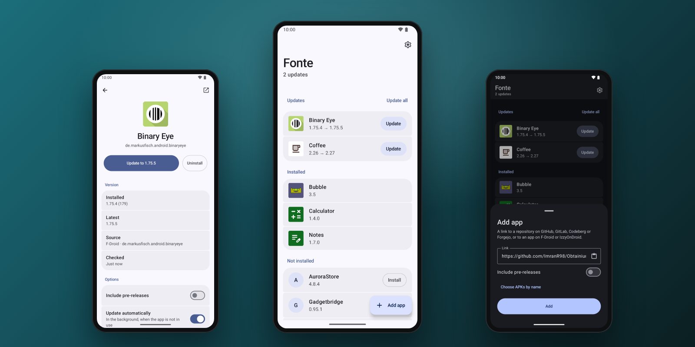

<div align="center">


# Fonte

**Open-source app updater for Android.**<br>
Installs and updates apps straight from their source. Fast, private and minimal. No trackers, no
Google Play Services.

[](#build)
[](#security)
[](https://github.com/Turtlecute33/Fonte/releases)
[](LICENSE)



</div>

## About

Fonte keeps the apps that you install from outside an app store up to date. Give it a link to a
repository or an app page. Fonte finds the latest release, picks the APK for your phone, checks it
and installs it.

It is an alternative to Obtainium, with fewer features and a smaller attack surface, and it imports
your Obtainium list. Fonte has no native code, no WebView and no dynamic code loading. It is made to
run on GrapheneOS with "Restrict dynamic code loading" (memory and storage) on.

## Features

- **Sources**: GitHub, GitLab (also self-hosted), Codeberg, Forgejo and Gitea, F-Droid and
  IzzyOnDroid.
- **The right APK**: the build for your processor, an optional name filter (regex), and
  pre-releases if you want them.
- **Background updates**: a check every 3, 6, 12 or 24 hours. Apps that Fonte installed update
  silently while you do not use them. Apps that another store installed ask you once, through a
  notification.
- **Fast checks**: HTTP/3 and HTTP/2, all apps at the same time, and a source with no change
  answers with an empty "not modified" reply.
- **Share to add**: share a repository link from your browser to Fonte.
- **Import and export**: the Obtainium export (any version), and Fonte's own list with the pinned
  certificates.
- **Material 3 Expressive**: your wallpaper colours, light and dark.

## Security

Before Fonte installs an APK, the APK must:

- match the SHA-256 digest that GitHub publishes for the file;
- be a valid, signed APK with native code (if any) for this device;
- keep the package name that the app had before;
- be signed with the pinned certificate. Fonte pins the certificate at the first install, or when
  it adopts an app that is installed already. A key rotation (APK signature scheme v3) is followed.

And also:

- **Update ownership** (Android 14): other installers need your consent to update an app that
  Fonte installed.
- **HTTPS only**, also after redirects. Only system CAs: a CA that you or an admin add is not
  trusted.
- **The GitHub token** is optional. It is encrypted with an Android Keystore key (StrongBox when
  available) and sent only to api.github.com. A redirect to another host drops it.
- **Release notes are plain text**. Fonte shows no HTML.
- **Memory tagging** (MTE) in sync mode on phones that have it, such as Pixel 8 and later.

## Privacy

- No analytics, no crash reporting, no Google Play Services, no third-party SDKs, no account.
- Fonte connects only to the sources in your list. When you add a link to an unknown host, Fonte
  asks that host if it runs GitLab, Forgejo or Gitea. An import contacts no host.
- No cookies, no HTTP cache, and a User-Agent with no device data.
- The clipboard is read only when you tap Paste.
- No backups: the app list and settings stay out of cloud backup and device transfer.
- Fonte reads the installed version of each app in your list (Android permission "query all
  packages"). This information stays on the phone.

## Download

Get the APK from [Releases](https://github.com/Turtlecute33/Fonte/releases). Fonte is new software.
Report problems in [Issues](https://github.com/Turtlecute33/Fonte/issues).

Before you install, check the signing certificate. Its SHA-256 fingerprint is:

```text
cc154a2b16d1b2021f233724054934162bf2980e161672640a6e0f388c36ffa4
```

Compare it with the output of `apksigner verify --print-certs <file>.apk`, or use AppVerifier.
Do not install an APK with a different certificate.

After the first start, allow Fonte to install apps when Android asks.

## Build

Requirements: JDK 21 and the Android SDK with platform 37.

```sh
JAVA_HOME=/opt/homebrew/opt/openjdk@21 ./gradlew :app:assembleDebug :app:testDebugUnitTest
```

Release builds are signed with the key that `scripts/make-release-key.sh` makes; without it,
`assembleRelease` makes an unsigned APK. The release APK is about 2.6 MB.

<details>
<summary><b>How Fonte finds updates</b></summary>

- **F-Droid and IzzyOnDroid**: the version code of the suggested version (with pre-releases on, the
  highest one). Fonte reads the small per-package API, not the multi-megabyte index. For apps with
  one build per ABI, a ranged request reads only the ZIP directory of each build, to find the
  build for this device before the download.
- **GitHub, GitLab, Codeberg, Forgejo and Gitea**: the 10 newest releases in one request. Fonte takes
  the newest one with an APK for this device. Drafts are skipped, and pre-releases are skipped
  unless you turn them on.
- After Fonte installs an app, it remembers the release tag and the version code. The next checks
  compare tags, which is exact. Before that, Fonte compares the version name with the tag.
- If the downloaded APK has the version that is installed already, Fonte installs nothing and
  only remembers the release.

</details>

<details>
<summary><b>Project layout</b></summary>

- `app/src/main/kotlin/app/fonte/net`: HTTPS through the platform HttpEngine (Cronet).
- `app/src/main/kotlin/app/fonte/source`: link parser, sources, APK choice, version compare.
- `app/src/main/kotlin/app/fonte/install`: download, checks, install sessions, installed packages.
- `app/src/main/kotlin/app/fonte/work`: periodic job and notifications.
- `app/src/main/kotlin/app/fonte/transfer`: Obtainium and Fonte import and export.
- `app/src/main/kotlin/app/fonte/ui`: theme, shared components, navigation and screens.

</details>

<details>
<summary><b>Validation</b></summary>

Run the JVM tests, lint and the two builds:

```sh
./gradlew :app:testDebugUnitTest :app:lintDebug :app:assembleDebug :app:assembleRelease
```

The tests cover the link parser, the APK choice, the version compare, the parsers of all
sources, the import formats, the store and the certificate pins.

On an Android 15 emulator, these steps were tested with real sources: add apps from each
source, first install, an update of an app that another installer owns, a silent update in
the background, the "tap to install" notification, and the Obtainium import. To run the
background job at once:

```sh
adb shell cmd jobscheduler run -f app.fonte 1
```

</details>

## License

Fonte is free software under the [GNU General Public License v3.0](LICENSE). It uses AndroidX,
Jetpack Compose and Kotlin coroutines (Apache-2.0), and Material Symbols icons (Apache-2.0).

---

<sub>Fonte is an independent project. It is not affiliated with Obtainium, F-Droid, IzzyOnDroid,
GitHub, GitLab or Codeberg.</sub>
